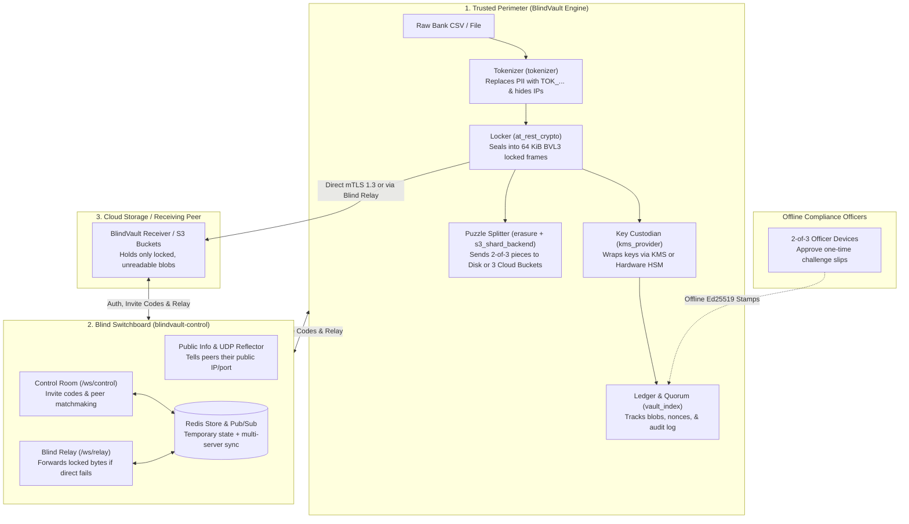

# BlindVault & BlindVault-Control — Complete Non-Technical Project Guide

Welcome to the plain-English guide to **BlindVault** and **BlindVault-Control**.  
This document explains what the whole system does, how the pieces talk to each other from start to finish, and what every single file in both projects is responsible for—without requiring a cryptography or systems-programming background.

---

## 1. What Problem Does This System Solve?

Imagine a bank or company that needs to:
1. **Store sensitive customer records** (names, national IDs, bank account numbers, IP addresses) on cheap cloud servers—without ever trusting those cloud servers to behave honestly.
2. **Send sensitive files directly to another trusted person or office** across the internet, even when firewalls or home/office routers block direct connections.
3. **Prove to regulators** that no single employee—not even an administrator with full access to the main server—can secretly read customer records without approval from multiple independent Compliance Officers.

The solution is split into two cooperating projects:
* **BlindVault** (the C++ engine & desktop app): Does all the locking, hiding, splitting, checking, and sending of data on your own trusted computers.
* **BlindVault-Control** (the Python control plane): Acts like a **blind switchboard operator**. It helps two BlindVault computers find each other across the internet using an 8-character invite code, and—if firewalls block them—forwards their locked messages without ever being able to open or read them.

### A Real-World Analogy

Think of **BlindVault** as an armored bank vault and **BlindVault-Control** as a neutral postal switchboard:
1. Before anything leaves the bank, names and account numbers are replaced with fake placeholder codes (only the bank holds the secret translation book).
2. The file is locked inside standardized steel boxes (`64 KiB` chunks) so an outsider cannot even guess whether a file has 10 records or 1,000.
3. A copy of the locked box is split into **3 puzzle pieces** stored in 3 separate places—if 1 warehouse catches fire or goes offline, any 2 remaining pieces rebuild the exact box.
4. When Alice wants to send a file to Bob, she asks the switchboard (**BlindVault-Control**) for a short 8-character room code (like `NJ4KW887`). Bob types the code, they verify each other's digital passports directly, and send the file. Even if they have to pass boxes *through* the switchboard, the boxes stay double-locked end-to-end—the switchboard only sees scrambled noise.
5. Later, if an auditor needs to inspect one customer's history, they get a **one-time, 5-minute permission slip**. At least **2 of 3 Compliance Officers** must stamp that slip offline on their own separate devices before BlindVault unlocks and translates just that customer's rows.

---

## 2. How Everything Connects (The Big Picture)

---

## 3. Step-by-Step Pipeline: From Start to Finish

### Pipeline A: Locking & Archiving Sensitive Data (`BlindVault` Vault Flow)
1. **Read & Scrub (`tokenizer`)**: BlindVault reads a transaction CSV line-by-line (so huge files don't fill up RAM). It replaces customer names, National IDs, and IBANs with deterministic placeholder tokens like `TOK_bd4089be7415073d`, and replaces IP addresses with `REDACTED_IP`. The secret mapping (`TOK_... <-> real name`) is itself locked and saved in `vault_tokens.enc`.
2. **Pad & Lock (`at_rest_crypto`)**: The scrubbed stream is cut into fixed `64 KiB` frames (`BVL3` format). Any leftover space in the last frame is filled with random noise. Each frame is locked with AES-256-GCM using a unique per-frame number and tagged with the blob's filename so nobody can swap files around behind the scenes.
3. **Protect the Keys (`kms_provider`)**: Each batch gets its own random key (DEK), which is immediately wrapped inside a Master Key (KEK). If a hardware security module (PKCS#11 HSM / SoftHSMv2) is connected, the Master Key **never even enters BlindVault's memory**—all wrapping and log-signing happens inside the hardware chip.
4. **Split for Resilience (`erasure_shard_backend` & `s3_shard_backend`)**: The locked `.enc` file is split into **3 erasure shards** (2-of-3). These can live on local folders or across 3 separate S3/MinIO cloud buckets. Losing 1 bucket does not lose data, and 1 stolen bucket reveals nothing.
5. **Record in Tamper-Proof Ledger (`vault_index`)**: `vault_index.tsv` records which tokens appear in which blobs, authenticated by a secret checksum (HMAC). Every action (`INGEST`, `QUORUM_RELEASE`, `QUORUM_DENIED`, `SHARD_RECOVERY`, `KEK_ROTATION`) is appended to `regtech_audit.log`, where each line's checksum chains onto the previous line—making silent deletion or editing impossible.

### Pipeline B: Peer-to-Peer Delivery Across Networks (`BlindVault` + `blindvault-control`)
1. **Digital Passports (`identity` & `trust_store`)**: Every BlindVault node has its own keypair (`identity.key` / `identity.crt`) and a 64-character SHA-256 **fingerprint**. You only talk to peers whose fingerprint you explicitly added to `trusted_peers.txt`.
2. **Checking Your Public Doorbell (`udp_reflector` + `control_client`)**: If connecting over the internet (`--control <url>`), BlindVault fetches the control server's public verification key (`/api/v1/info`) and sends a small UDP ping (`BVST`). `blindvault-control` replies with the IP and port it sees you coming from, signed with its Ed25519 key so no attacker can lie about your address.
3. **Handshake & Matchmaking (`signaling` + `control_client`)**: BlindVault connects over WebSocket (`/ws/control`), proves it owns its private key by signing a one-time random challenge (`HELLO -> CHALLENGE -> AUTH -> AUTH_OK`), and either creates an 8-character Crockford invite code (`CREATE_INVITE`) or claims one (`CLAIM_INVITE`). The server introduces the two peers without ever sharing their server-observed private IPs unless they explicitly declare hints.
4. **Direct Tunnel or Blind Fallback Relay (`client_node` / `server_node` + `relay`)**:
   - First, the sender tests if the receiver's address is directly reachable over TCP. If yes, they connect directly.
   - If firewalls block direct connections (or `--force-relay` is used), the sender asks `blindvault-control` to open a relay room (`CREATE_RELAY`), which hands each peer a secret single-use token. Both sides attach to `/ws/relay/{session_id}` using a private `Authorization: Bearer` header (never in the URL) and pump **end-to-end TLS 1.3** traffic through binary WebSocket frames. `blindvault-control` cannot read a single byte of the file or even the filenames inside.

### Pipeline C: Quorum-Approved Audit & Recovery (`vault_gateway`)
1. **One-Time Challenge**: An auditor asks BlindVault for a release challenge for a customer (`vault challenge` or GUI button). BlindVault creates a 16-byte random `challenge_nonce_hex` and a 5-minute `expires_utc` deadline, saving them in the signed index.
2. **Offline Officer Approval**: At least **2 Compliance Officers** run `officer-sign` on their own offline laptops/HSMs, signing the exact combination of officer ID, token, blob name, wrapped key, challenge nonce, and expiration time.
3. **Verify, Recover if Needed, & Translate**:
   - BlindVault checks that the challenge exists, hasn't expired, and hasn't been used before—then marks it **consumed** so signatures can never be replayed.
   - It verifies both Ed25519 signatures against the officers' public keys (`*.pub`).
   - It streams and decrypts the cloud `.enc` blob. **If the cloud file was deleted or corrupted**, BlindVault automatically fetches 2 of the 3 erasure shards, rebuilds the `.enc` file, verifies its cryptographic tag, and logs `SHARD_RECOVERY`.
   - Only rows matching the target customer are translated back to real names/IDs; everything else stays hidden, and temporary memory is wiped immediately.

---

## 4. File-by-File Reference: `BlindVault` (C++20 / Qt 6)

Root directory: `z:\home\omar-25th\projects\BlindVault`

### Top-Level Build, Config & Docs
| File | What It Does & Its Role in the Pipeline |
| :--- | :--- |
| `CMakeLists.txt` | Master build recipe. Bundles the reusable C++ modules into a static library (`blindvault_core`), then builds the CLI (`BlindVault`), optional desktop GUI (`BlindVault_GUI`), unit tests (`unit_tests`), fuzzer (`fuzz_validation`), and benchmarks (`bench_vault`). |
| `docker-compose.vault.yml` | Launches a local 3-node MinIO S3 storage cluster (`minio0`, `minio1`, `minio2`) plus an automatic setup container (`minio-init`) that creates `blindvault-shard0/1/2` buckets for testing multi-bucket erasure coding. |
| `README.md` | Developer quick-start, protocol byte layouts (`BVL3`, `BVL2`, `BVTK`), CLI command reference, and benchmark summary. |
| `PROJECT_GUIDE.md` | This non-technical, file-by-file architectural guide. |
| `benchmark_results.json` | Saved raw output from Google Benchmark runs. |
| `LICENSE` | MIT open-source license. |

### Command-Line Entry Point (`src/`)
| File | What It Does & Its Role in the Pipeline |
| :--- | :--- |
| `src/main.cpp` | The main CLI dispatcher (`BlindVault`). Routes commands for identity setup (`init`, `fingerprint`, `trust`), direct or control-plane file transfers (`send`, `receive`, `p2p` with `--control`, `--invite`, `--claim`, `--force-relay`), RegTech vault operations (`vault offload`, `vault challenge`, `vault query`, `vault rotate-kek`), offline officer tools (`officer-keygen`, `officer-sign`), and quick pipeline benchmarks (`bench`). |

### Vault & Cryptography Engine (`include/vault/` & `src/vault/`)
| File Pair (`.hpp` + `.cpp`) | What It Does & Its Role in the Pipeline |
| :--- | :--- |
| `at_rest_crypto` | Core locking engine: random key generation, `OPENSSL_cleanse` RAM-wiping containers (`SecretKey`, `SecretBuffer`), RFC 3394 key wrapping, legacy `BVL2` envelopes, streaming `BVL3` 64 KiB frame encryption/decryption (`Bvl3EncryptingStreamBuf`, `decrypt_stream_auto`), and 2-of-3 XOR erasure splitting/reconstruction. |
| `tokenizer` | Reads and writes CSV records line-by-line in constant memory (`sanitize_csv_stream`, `rehydrate_csv_stream`), turns PII columns into `TOK_...` tokens using OpenSSL 3 `EVP_MAC`, redacts IP addresses, and persists the encrypted `BVTK` lookup vault (`vault_tokens.enc`). |
| `kms_provider` | Key custody abstraction (`KeyManagementProvider`). Provides `LocalSoftwareKmsProvider` (stores `hsm_master.kek` locally with `0600` permissions) and `Pkcs11HsmProvider` (talks directly to hardware HSMs / SoftHSMv2 via `dlopen` so non-extractable Master Keys never enter RAM). |
| `vault_index` | Manages `MetadataIndex` (`vault_index.tsv`), `QuorumGate` (verifies offline Ed25519 officer signatures bound to single-use nonces and UTC expiries), offline keygen/signing helpers, and the tamper-evident HMAC hash-chained audit log (`regtech_audit.log`). |
| `erasure_shard_backend` | Defines the pluggable `ErasureShardBackend` interface (`write_shard`, `read_shard`) and `LocalErasureShardBackend`, which saves/reads `.shard0/.shard1/.shard2` files on local disk. |
| `s3_shard_backend` | Implements `S3MultiBucketShardBackend` using Boost.Beast HTTP/HTTPS + OpenSSL TLS with full AWS Signature Version 4 (`AWS4-HMAC-SHA256`) signing for `PUT`, `GET`, and `HEAD` across 3 independent S3/MinIO buckets (`BLINDVAULT_SHARD{0,1,2}_URL`). |
| `vault_gateway` | The central RegTech orchestrator (`GatewayEngine`). Connects `TokenVault`, `MetadataIndex`, `QuorumGate`, `KmsProvider`, and `ErasureShardBackend` to run streaming offload, challenge issuance, quorum-gated auditing with automatic shard recovery, and crash-safe KEK rotation (`rotation.journal` + `.rotation_backup`). |
| `include/vault/cli_benchmark.hpp` | Runs the self-contained synthetic CBE transaction benchmark invoked by `BlindVault bench [rows]`. |

### Identity, Trust & Safety (`include/security/` & `src/security/`)
| File | What It Does & Its Role in the Pipeline |
| :--- | :--- |
| `identity` (`.hpp` + `.cpp`) | Generates each node's EC P-256 private key (`identity.key`) and self-signed certificate (`identity.crt`), checks key passphrases, and computes SHA-256 certificate fingerprints. |
| `trust_store` (`.hpp` + `.cpp`) | Manages `trusted_peers.txt`—validating fingerprint formatting, adding/listing/removing trusted peers, and preventing accidental duplicates. |
| `tls_trust` (`.hpp` + `.cpp`) | Configures OpenSSL **TLS 1.3 only** contexts for both clients and servers, enforces strict certificate fingerprint pinning against `TrustStore`, and prints helpful `BlindVault trust add` guidance when an unknown peer connects. |
| `include/security/cli_identity.hpp` | Handles the `init`, `fingerprint`, and `trust` CLI subcommands and password prompts. |
| `include/security/validation.hpp` | Guards against malformed headers and dangerous filenames (blocking path traversal `../`, Windows reserved names like `CON`/`NUL`, NTFS alternate data streams `:`, and control characters). |
| `include/security/disk_budget.hpp` | Tracks concurrent incoming file transfers so simultaneous uploads cannot fill the disk past a 100 MiB safety margin. |

### Network Transport & Control-Plane Client (`include/transport/` & `src/transport/`)
| File | What It Does & Its Role in the Pipeline |
| :--- | :--- |
| `include/transport/common/protocol.hpp` | Defines the fixed 47-byte big-endian transfer header (`METADATA`, `CHUNK`, `END_OF_FILE`, `ACK`) and acknowledgement status codes. |
| `include/transport/common/file_streaming.hpp` | Streams files in 64 KiB chunks while computing an incremental SHA-256 integrity hash. |
| `include/transport/common/events.hpp` | Callback hooks (`on_progress`, `on_finished`, `on_peer`) used by both CLI and the Qt 6 GUI to report live transfer progress. |
| `client_node` (`include/transport/client/client_node.hpp` + `src/transport/client_node.cpp`) | Connects to a receiver over mutual TLS 1.3, sends the 47-byte header and filename, streams file chunks, and waits for SHA-256 confirmation. Includes early-alert draining so `unknown ca` rejections report friendly trust hints instead of raw `Broken pipe` errors. |
| `include/transport/client/p2p_node.hpp` | Combines a `ServerNode` and `ClientNode` into a single bidirectional peer node with a local peer address book. |
| `server_node` (`include/transport/server/server_node.hpp` + `src/transport/server_node.cpp`) | Listens on a TCP port (capping concurrent connections at 64) and spawns a `ServerSession` for each incoming peer. |
| `server_session` (`include/transport/server/server_session.hpp` + `src/transport/server_session.cpp`) | Handles one incoming TLS 1.3 transfer: verifies peer identity, validates filename and disk budget, writes to a `.part` temp file, verifies the SHA-256 hash, atomically renames the file, and sends `ACK`. |
| `control_client` (`include/transport/control/control_client.hpp` + `src/transport/control/control_client.cpp`) | Connects BlindVault to `blindvault-control`: reads `/api/v1/info`, verifies Ed25519-signed UDP reflections (`BVST`), completes ECDSA challenge auth on `/ws/control`, manages invites/claims/signaling, and runs `RelayTcpBridge` (`LocalRelayProxy` / `bridge_to_local_server`) to tunnel mTLS 1.3 inside binary WebSocket relay frames. |

### Desktop GUI (`gui/`)
| File | What It Does & Its Role in the Pipeline |
| :--- | :--- |
| `gui/main_gui.cpp` | Qt 6 application entry point; sets Fusion dark-theme styling and launches `MainWindow`. |
| `gui/main_window.hpp` & `.cpp` | Three-tab desktop console: **1. Bank Egress Gateway** (synthetic batch/CSV offload + progress), **2. Quorum Auditor & Cloud Proof** (import `*.pub`, generate replay-proof challenges, paste 2 officer signatures, view re-hydrated table + raw cloud hex dump), **3. Cloud Vault & Node Trust** (start receiver & manage trusted fingerprints). |
| `gui/network_bridge.hpp` & `.cpp` | Separates heavy CPU work (`GatewayEngine` tokenization, `BVL3` encryption, erasure sharding, auditor queries) onto a dedicated `cpu_pool_` thread pool so the TLS network loop (`io_ctx_`) and Qt UI stay responsive. |
| `gui/log_redirect.hpp` | Forwards C++ `std::cout` / `std::cerr` lines live into the GUI activity log window. |

### Tests, Fuzzing, Benchmarks & CI
| Path | What It Does |
| :--- | :--- |
| `tests/test_vault_core.cpp` | End-to-end GoogleTest suite covering `BVL2`/`BVL3` encryption, streaming tokenizer parity, replay-proof nonces & expiries, 2-of-3 shard recovery (missing & corrupted blobs), crash-safe KEK rotation, 3-bucket mock HTTP S3 recovery, UDP Ed25519 verification, and live SoftHSMv2 PKCS#11 hardware round-trips. |
| `tests/test_protocol.cpp`, `test_validation.cpp`, `test_disk_budget.cpp`, `test_trust_store.cpp`, `test_identity.cpp`, `test_tls_trust.cpp`, `test_hashing.cpp`, `test_e2e_trust.cpp` | Focused unit and integration tests for headers, filename safety, disk budgets, trust lists, EC P-256 identity generation, TLS pinning, SHA-256 streaming, and untrusted peer (`Mallory`) refusal. |
| `fuzz/fuzz_validation.cpp` & `fuzz/seeds/` | LibFuzzer target feeding random/malformed inputs into header and filename validators to catch crashes or hangs. |
| `benchmarks/bench_vault.cpp` | Google Benchmark microbenchmarks for CSV tokenization, 64 KiB encryption, 2-of-3 erasure split, and full pipeline throughput. |
| `scripts/e2e_test.sh` & `scripts/gen_certs.sh` | Automated Linux CLI end-to-end test (Alice, Bob, and untrusted Mallory) and helper cert scripts. |
| `docs/images/*.png` | Screenshots of the Qt 6 GUI. |
| `.github/workflows/ci.yml` & `release.yml` | Automated CI pipelines (GCC, Clang, ASan+UBSan, SoftHSMv2 PKCS#11 HSM, 60s libFuzzer) and Linux AppImage / Windows MSVC release builds. |

---

## 5. File-by-File Reference: `blindvault-control` (Python 3.12+ / FastAPI)

Root directory: `z:\home\omar-25th\projects\blindvault-control`

### Packaging, Config & Deployment
| File | What It Does & Its Role in the Pipeline |
| :--- | :--- |
| `pyproject.toml` | Defines Python 3.12+ dependencies (`fastapi`, `uvicorn`, `redis`, `cryptography`, `pydantic`, `structlog`), test/lint settings (`pytest`, `ruff`, `mypy --strict`), and the `blindvault-control` CLI entry point. |
| `Dockerfile` | Multi-stage container image running `blindvault-control` as a non-root user on port `8000` (HTTP/WS) and `3478/udp` (UDP reflector). |
| `docker-compose.yml` | Spins up Redis 7+ alongside the `blindvault-control` container with health checks and configured ports. |
| `README.md` | Control-plane API reference, wire protocol specs, security design notes, and deployment guide. |

### Core Control-Plane Modules (`src/blindvault_control/`)
| File | What It Does & Its Role in the Pipeline |
| :--- | :--- |
| `__init__.py` | Package version metadata (`__version__`). |
| `config.py` | Centralized Pydantic settings loaded from `BLINDVAULT_*` environment variables (Redis URL, ports, TTLs, frame size limits, rate-limit thresholds, IP-scrubbing toggle, and `UDP_SIGNING_PRIVATE_KEY`). |
| `crypto.py` | Handles EC P-256 public key parsing (`secp256r1` only), SHA-256 SPKI fingerprint calculation (matching BlindVault's `ControlClient`), 32-byte challenge nonce generation, ECDSA-SHA256 verification, and 8-character Crockford Base32 invite code generation/normalization (e.g. turning `I`/`L` -> `1`, `O` -> `0`). |
| `schemas.py` | Strict Pydantic v2 definitions for every JSON message exchanged on `/ws/control`: `HELLO`, `CHALLENGE`, `AUTH`, `AUTH_OK`, `AUTH_FAILED`, `PING`, `PONG`, `CREATE_INVITE`, `INVITE_CREATED`, `CLAIM_INVITE`, `PEER_MATCHED`, `SIGNAL_OFFER`, `SIGNAL_ANSWER`, `HOLE_PUNCH_SYNC`, `CREATE_RELAY`, `RELAY_CREATED`, `RELAY_INVITE`, and `ERROR`. |
| `redis_store.py` | Ephemeral state manager backed by async Redis with automatic TTL expiration—no SQL database, no permanent social graph. Stores single-use auth nonces (`GETDEL`), online peer presence, atomic invite consumption, relay session metadata/slot claims (`HSETNX`), and Pub/Sub publishing. |
| `rate_limiter.py` | Sliding-window / token-bucket limiter protecting handshake attempts (per IP), invite creation, invite claims (per fingerprint + per IP), and relay creation against spam or brute-force guessing. |
| `udp_reflector.py` | Async UDP server (`b"BVST"`) that tells peers their external IP and port, stamped with an **Ed25519 signature** (`64B`) so attackers cannot forge NAT reflections. Exports the raw 32-byte Ed25519 public key for `/api/v1/info`. |
| `signaling.py` | Runs `/ws/control` sessions: checks Origin headers, enforces ECDSA challenge-response auth, refreshes presence on `PING`, handles invite creation/claiming (`PEER_MATCHED` sends only client-declared endpoints—never server-observed IPs), forwards hole-punch signaling, and routes messages across multiple server replicas via Redis Pub/Sub (`bv:peer:{fingerprint}`). |
| `relay.py` | Runs `/ws/relay/{session_id}`: validates single-use Bearer tokens, enforces **binary-only frames** up to `64 KiB`, detaches cleanly on early disconnects, and bridges encrypted peer streams either locally in memory or across separate server replicas using Redis Pub/Sub channels (`bv:relay:{sid}:a2b` / `b2a`). |
| `main.py` | Application factory (`create_app()`) and Uvicorn runner. Initializes Redis, managers, Ed25519 UDP signing keypair, optional IP-scrubbing JSON logger (`SCRUB_IPS_IN_LOGS`), `/health` & `/ready` probes, `/api/v1/info`, `/ws/control`, and `/ws/relay/{session_id}` (reading tokens from `Authorization: Bearer`, `X-Relay-Token`, or subprotocol headers). |

### Control-Plane Tests & Benchmarks
| File | What It Does |
| :--- | :--- |
| `benchmarks/bench_control.py` | Measures authentication handshake latency, signaling throughput, and relay forwarding speed. |
| `tests/conftest.py` | Shared pytest fixtures, including `fakeredis` and the `two_live_servers` fixture simulating 2 horizontally scaled control-plane replicas sharing Redis Pub/Sub. |
| `tests/test_auth_and_presence.py` | Tests ECDSA challenge auth, invalid signatures, nonce replay rejection, oversized frames, Origin validation, `/ready`, and IP log scrubbing. |
| `tests/test_crypto.py` | Tests EC P-256 PEM/DER parsing, rejection of wrong curves/RSA, fingerprints, and Crockford invite normalization. |
| `tests/test_pairing_and_signaling.py` | Tests invite creation/claiming, zero-knowledge endpoint privacy, self-pairing rejection, signaling forwarding, and cross-replica Pub/Sub signaling. |
| `tests/test_rate_limiter.py` | Tests handshake, invite, claim, and relay rate limits and token refill. |
| `tests/test_relay.py` | Tests 10 MiB end-to-end binary relay transfers, frame size limits, text-frame rejection (`1003`), early disconnect cleanup, and cross-replica relay bridging. |
| `tests/test_udp_reflector.py` | Tests Ed25519 key formats, IPv4/IPv6 `"BVST"` packet packing/verification, tamper detection, and live `/api/v1/info` + UDP probe verification. |
