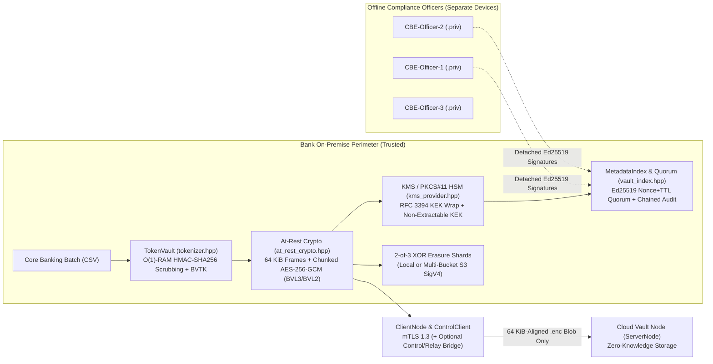

# BlindVault — Hardened Zero-Knowledge RegTech Storage Gateway

A high-throughput, zero-knowledge storage gateway and secure transfer engine written in C++20 with Boost.Asio, Boost.Beast, OpenSSL 3, and Qt 6. Designed for banking and RegTech compliance, **BlindVault** sits between a bank's core transaction perimeter and low-cost commodity cloud storage—streaming CSV batches through an `O(1)`-RAM HMAC tokenizer, encrypting payloads at rest with **chunked streaming AES-256-GCM (`BVL3`)** aligned to fixed 64 KiB buckets (with automatic legacy `BVL2` read compatibility), wrapping batch keys under a Master KEK via **RFC 3394** (backed by PKCS#11 HSM or local software KMS), splitting 2-of-3 erasure shards across local or multi-bucket S3 object stores, and streaming blobs over **mutual TLS 1.3** (direct or via the companion `blindvault-control` NAT-traversal / relay control plane).

Even if the remote storage server is compromised or inspected by an untrusted administrator, the cloud node holds zero customer identities, zero IP metadata, zero batch-size signals, and zero decryption keys. Inside the bank perimeter, unmasking customer PII requires **2-of-3 Compliance Officer Quorum** cryptographic sign-off using **offline detached Ed25519 signatures** bound to single-use CSPRNG challenge nonces and UTC expirations—the gateway stores only officer public keys (`*.pub`) and cannot mint approvals or replay consumed challenges.

## Contents

* [Architecture & Hardened RegTech Pipeline](#architecture--hardened-regtech-pipeline)
* [Core & Hardening Features](#core--hardening-features)
* [Quick Start](#quick-start)
* [Hardware HSM Configuration (PKCS#11)](#hardware-hsm-configuration-pkcs11)
* [Opening the Qt 6 Desktop Console](#opening-the-qt-6-desktop-console)
* [CLI Usage](#cli-usage)
* [Multi-Bucket S3 Erasure & Control-Plane Rendezvous](#multi-bucket-s3-erasure--control-plane-rendezvous)
* [Performance Benchmarks](#performance-benchmarks)
* [How It Works](#how-it-works)
* [Threat Model](#threat-model)
* [Known Limitations](#known-limitations)
* [Testing & Fuzzing](#testing--fuzzing)
* [Project Structure](#project-structure)
* [License](#license)

## Architecture & Hardened RegTech Pipeline

BlindVault separates **identity, key custody, and quorum governance** (strictly inside the bank's perimeter) from **bulk encrypted storage** (offloaded to low-cost commodity object/disk storage):



1. **O(1)-RAM Streaming Tokenization & Encrypted Token Vault (`tokenizer.hpp` / `tokenizer.cpp`):** Parses RFC 4180 transaction records line-by-line via `sanitize_csv_stream`, replaces customer names, National IDs, and IBANs with deterministic `TOK_<16-hex>` HMAC-SHA256 tokens using a KMS-derived pepper, and redacts source IP addresses (`REDACTED_IP`). Persists bidirectional mappings atomically in `vault_tokens.enc` (`BVTK` AES-256-GCM envelope with a KMS-wrapped DEK and `0600` permissions).
2. **Chunked Streaming AEAD & Traffic-Analysis Padding (`at_rest_crypto.hpp` / `at_rest_crypto.cpp`):** Seals tokenized output in fixed **65,536-byte (`64 KiB`)** **AES-256-GCM** frames (`BVL3`) using per-chunk deterministic nonces (`base_iv XOR uint64_be(chunk_index)`) and AAD binding `(blob_name || chunk_index || is_final)` to prevent truncation, reordering, and blob-swap attacks—while keeping memory strictly `O(1)` (~64 KiB per stream) and automatically decrypting legacy `BVL2` blobs.
3. **PKCS#11 HSM / KMS Key Wrapping, Crash-Safe KEK Rotation & Erasure Sharding (`kms_provider.hpp`, `s3_shard_backend.hpp`):** Wraps each batch's Data Encryption Key (DEK) under a Master Key Encryption Key (KEK) via **RFC 3394 (`CKM_AES_KEY_WRAP` / `EVP_aes_256_wrap`)**, enforces non-extractable keys (`CKA_EXTRACTABLE=FALSE`), performs crash-safe atomic KEK rotation via `rotation.journal` + `.rotation_backup`, and distributes **2-of-3 XOR erasure shards** across local disk or 3 independent S3-compatible buckets using AWS SigV4 (`PUT`/`GET`/`HEAD`). If the primary cloud `.enc` blob is missing or fails GCM authentication, `auditor_query` automatically reconstructs and verifies the blob from any 2 surviving shards and records a `SHARD_RECOVERY` entry in the hash-chained audit log.
4. **Zero-Trust Transport & Control-Plane Rendezvous (`client_node.hpp`, `control_client.hpp`):** Streams `.enc` blobs over **TLS 1.3** with mutual certificate fingerprint pinning, SHA-256 verification, and resilient early TLS alert (`unknown ca`) draining. Optionally integrates with [blindvault-control](https://github.com/OmarAhmedTHE25th/BlindVault-Control/tree/main) over WebSockets + Ed25519-signed UDP reflection (`BVST`) + `RelayTcpBridge` (passing bearer tokens in `Authorization` headers and preserving end-to-end mTLS 1.3 inside binary WebSocket frames).
5. **Replay-Proof Ed25519 Quorum Auditor Re-Hydration (`vault_index.hpp` & `vault_gateway.hpp`):** Each Compliance Officer generates an Ed25519 keypair offline (`officer-keygen`) and installs only their public key (`*.pub`) on the gateway. `prepare_release_challenge` mints a fresh 16-byte CSPRNG `challenge_nonce_hex` and UTC ISO-8601 `expires_utc` (default 5 minutes), persisted under `MetadataIndex` HMAC. At least **2 of 3 Compliance Officers** sign `(officer_id|target_token|blob_name|wrapped_dek_hex|challenge_nonce_hex|expires_utc)`. Upon quorum verification, the gateway consumes the challenge single-use, stream-decrypts matching rows in `O(1)` memory, re-hydrates tokens, cleanses RAM, and appends to the HMAC hash-chained `regtech_audit.log`.

## Core & Hardening Features

* **Zero-Knowledge Cloud Offloading:** Remote storage nodes only receive 64 KiB-aligned `BVL3`/`BVL2` AES-256-GCM ciphertext blobs—never plaintext PII, internal IP addresses, batch size signatures, or AES keys.
* **True Separation of Duties (Offline Ed25519 2-of-3 Quorum):** `QuorumGate` stores **only** officer Ed25519 public keys (`*.pub`) on the gateway host and has zero in-process signing capability. Even full root compromise of the gateway host cannot forge a 2-of-3 approval without the officers' offline private keys.
* **PKCS#11 Hardware HSM & Software KMS (`kms_provider.hpp`):** Pluggable `KeyManagementProvider` supporting FIPS 140-3 PKCS#11 v2.40 HSMs (SoftHSMv2, AWS CloudHSM, Thales Luna, Utimaco) where the Master KEK never enters process memory (`CKA_EXTRACTABLE=FALSE`), with seamless local `0600` KEK fallback and full Master KEK rotation (`rotate_master_kek`).
* **RFC 3394 Envelope Key Wrapping & Blob-Swap Protection:** Per-batch DEKs are wrapped with a 256-bit Master KEK before persisting to `vault_index.tsv`; blob filenames are authenticated via GCM AAD so ciphertext blobs cannot be swapped across index records.
* **Tamper-Evident Index & Hash-Chained Audit Log:** `vault_index.tsv` is authenticated with a domain-separated HMAC-SHA256 MAC (`blindvault:index-auth:v1`), and `regtech_audit.log` links every sequence entry to the previous entry's HMAC (`blindvault:audit-auth:v1`).
* **RAII Memory Zeroization & Core-Dump Lock:** Move-only `SecretKey` and `SecretBuffer` types scrub sensitive material from RAM with `OPENSSL_cleanse()` on move and destruction, paired with `RLIMIT_CORE=0` process hardening.
* **2-of-3 XOR Erasure Coding:** Generates 3 parity/data shards per encrypted batch so any 2 storage providers reconstruct the full ciphertext while 1 compromised or offline provider reveals nothing.
* **Encrypted Bidirectional Token Vault (`BVTK`):** In-memory O(1) `TokenVault` backed by KMS-derived HMAC-SHA256 peppers and atomic AES-256-GCM disk persistence (`vault_tokens.enc`).
* **Mutual TLS 1.3 with Per-Node Identities & Resilient Alert Propagation:** Only TLS 1.3 is accepted. Each node generates an EC P-256 keypair and self-signed certificate (with optional AES-256-CBC private key passphrase encryption), authenticating peers strictly via SHA-256 certificate fingerprints (`trusted_peers.txt`). If a receiver rejects an untrusted peer (e.g., Mallory test scenario) and drops the connection with an `unknown ca` TLS alert during early header or filename transmissions, the sender gracefully drains the pending alert from the socket rather than misattributing the failure to an ambiguous `Broken pipe` or connection reset.
* **Disk Exhaustion Protection & Atomic Staging (`disk_budget.hpp`, `validation.hpp`):** Concurrent uploads reserve space from a shared mutex-protected budget keeping a 100 MiB safety margin, write to `.part` files, and rename atomically only after SHA-256 verification.

## Quick Start

Tested on Ubuntu 24.04 (including WSL) with GCC 13 and Clang 18.

```bash
# 1. Install dependencies (Debian/Ubuntu)
sudo apt update
sudo apt install -y build-essential cmake ninja-build libboost-dev libboost-system-dev libssl-dev

# 2. Clone and build
git clone https://github.com/OmarAhmedTHE25th/BlindVault.git
cd BlindVault
cmake -S . -B build -G Ninja
cmake --build build

# 3. (Optional) Symlink into ~/.local/bin so `BlindVault` and `bv` work from anywhere
mkdir -p ~/.local/bin
ln -sf "$(pwd)/build/BlindVault" ~/.local/bin/BlindVault
ln -sf "$(pwd)/build/BlindVault" ~/.local/bin/bv
```

## Hardware HSM Configuration (PKCS#11)

By default, BlindVault uses `LocalSoftwareKmsProvider` (storing `hsm_master.kek` with `0600` permissions). On Linux/POSIX systems, set two environment variables to bind directly to any PKCS#11 v2.40 HSM (e.g., SoftHSMv2, AWS CloudHSM, Thales Luna) with zero external SDK headers required:

```bash
export BLINDVAULT_PKCS11_MODULE=/usr/lib/softhsm/libsofthsm2.so
export BLINDVAULT_PKCS11_PIN=1234
```

The HSM token must contain three non-extractable secret keys labeled `blindvault-master-kek` (`CKK_AES`), `blindvault-index-hmac` (`CKK_GENERIC_SECRET`), and `blindvault-audit-hmac` (`CKK_GENERIC_SECRET`).

## Opening the Qt 6 Desktop Console

The desktop application provides a three-tab RegTech operations and audit console:

1. **Bank Egress Gateway:** Generate synthetic Egyptian banking transaction batches (`10,000` records) or load a CSV, scrub PII/IPs, pad to 64 KiB, wrap DEKs via RFC 3394, generate 2-of-3 erasure shards, inspect live `records/sec` throughput telemetry, and stream `.enc` blobs to the cloud node.
2. **Quorum Auditor & Cloud Proof:** Import officer Ed25519 public keys (`*.pub`), click **1. Prepare Signing Challenge** to inspect the target token, blob name, wrapped DEK, and exact offline `officer-sign` CLI command, paste detached 128-hex Ed25519 signatures from at least 2 officers, and click **2. Verify & Re-Hydrate** to view the decrypted bank table alongside a raw hex dump proving what resides on the cloud disk.
3. **Cloud Vault & Node Trust:** Start the local cloud storage receiver node and manage pinned SHA-256 node fingerprints.

```bash
# Install Qt 6 development packages
sudo apt install -y qt6-base-dev libgl1-mesa-dev

# Configure and build the GUI
cmake -S . -B build-gui -G Ninja -DP2P_BUILD_GUI=ON -DP2P_BUILD_TESTS=OFF
cmake --build build-gui --target BlindVault_GUI

# Launch
./build-gui/BlindVault_GUI
```

## CLI Usage

The underlying transport binary supports headless CLI transfers, bidirectional P2P sessions, offline officer Ed25519 quorum ceremonies, and node identity management:

```text
BlindVault receive <port> [save_folder] [--control <url> --invite|--claim <code>]
BlindVault send <host> <port> <file>
BlindVault send <file> --control <url> (--invite|--claim <code>) [--force-relay]
BlindVault p2p <port> [save_folder] [--control <url> --invite|--claim <code>]

RegTech Vault Gateway & Benchmark Commands:
  BlindVault vault offload <raw_csv> [--state-dir DIR] [--cloud-dir DIR]
  BlindVault vault challenge <identifier> [--state-dir DIR] [--ttl SECONDS]
  BlindVault vault query <identifier> <cloud_dir> --nonce <hex> --expires <iso> --approval <officer_id>:<sig_hex> [--approval ...] [--state-dir DIR]
  BlindVault vault rotate-kek [--state-dir DIR] [--cloud-dir DIR]
  BlindVault bench [rows]

Compliance Officer Offline Quorum Commands (run on officer workstation):
  BlindVault officer-keygen <officer_id> [out_dir]
  BlindVault officer-sign <priv_key.pem> <officer_id> <token> <blob_name> <wrapped_dek_hex> <challenge_nonce_hex> <expires_utc>

Identity Management:
  BlindVault init [--force] [name]
  BlindVault fingerprint
  BlindVault trust add <fingerprint> <name>
  BlindVault trust list
  BlindVault trust remove <name|fingerprint>
```

### Setting Up Two Nodes & Offline Officer Keys Locally

```bash
cd build
mkdir bank_gateway cloud_vault offline_officers

# 1. Generate EC P-256 node identities
(cd bank_gateway && ../BlindVault init bank_gateway < /dev/null)
(cd cloud_vault  && ../BlindVault init cloud_vault < /dev/null)

# 2. Exchange and pin certificate fingerprints
(cd bank_gateway && ../BlindVault trust add "$(cd ../cloud_vault && ../BlindVault fingerprint | sed 's/^Your fingerprint: //')" cloud_vault)
(cd cloud_vault  && ../BlindVault trust add "$(cd ../bank_gateway && ../BlindVault fingerprint | sed 's/^Your fingerprint: //')" bank_gateway)

# 3. Generate offline Ed25519 officer keypairs and install ONLY *.pub on the gateway
../BlindVault officer-keygen CBE-Officer-1 offline_officers
../BlindVault officer-keygen CBE-Officer-2 offline_officers
../BlindVault officer-keygen CBE-Officer-3 offline_officers
mkdir -p ~/.local/share/BlindVault/BlindVault/officers
cp offline_officers/*.pub ~/.local/share/BlindVault/BlindVault/officers/

# 4. Start Cloud Vault listener (Terminal 1)
(cd cloud_vault && ../BlindVault receive 8080)

# 5. Send an encrypted blob from Bank Gateway (Terminal 2)
(cd bank_gateway && ../BlindVault send localhost 8080 payload.enc)
```

## Multi-Bucket S3 Erasure & Control-Plane Rendezvous

### Multi-Bucket S3 Erasure Coding (`S3MultiBucketShardBackend`)

Spin up 3 independent MinIO buckets locally and offload shards via AWS SigV4:

```bash
docker compose -f docker-compose.vault.yml up -d
export BLINDVAULT_SHARD0_URL=http://127.0.0.1:9000/blindvault-shard0
export BLINDVAULT_SHARD1_URL=http://127.0.0.1:9002/blindvault-shard1
export BLINDVAULT_SHARD2_URL=http://127.0.0.1:9004/blindvault-shard2
export AWS_ACCESS_KEY_ID=minioadmin
export AWS_SECRET_ACCESS_KEY=minioadmin

./build/BlindVault vault offload batch.csv --state-dir ./bank_state --cloud-dir ./cloud_archive
```

### Control-Plane NAT Traversal & Encrypted Fallback Relay

Pair peers via Crockford invite codes and stream end-to-end mTLS 1.3 directly or through `blindvault-control` WebSocket relay bridges:

```bash
# Terminal 1 (Receiver)
./build/BlindVault receive 8443 ./received --control http://127.0.0.1:8000 --invite

# Terminal 2 (Sender — direct TCP if reachable, or automatic / forced relay fallback)
./build/BlindVault send ./payload.enc --control http://127.0.0.1:8000 --claim ABCD1234 --force-relay
```

## Performance Benchmarks

Microbenchmarks and end-to-end pipeline benchmarks were executed using Google Benchmark (`bench_vault`) under the following environment:

```text
Run on (8 X 2419.2 MHz CPU s)
CPU Caches:
  L1 Data 48 KiB (x4)
  L1 Instruction 32 KiB (x4)
  L2 Unified 1280 KiB (x4)
  L3 Unified 8192 KiB (x1)
Load Average: 1.20, 0.81, 0.85
```

### Benchmark Summary

| Benchmark | Batch / Payload Size | Real Time | CPU Time | Iterations | Throughput | Item Rate |
| :--- | :--- | :--- | :--- | :--- | :--- | :--- |
| `BM_TokenizeCsvBatch/1000` | 1,000 records | 0.315 ms | 0.298 ms | 2,352 | 408.32 MiB/s | 3.36 M items/s |
| `BM_TokenizeCsvBatch/10000` | 10,000 records | 2.15 ms | 2.04 ms | 336 | 595.96 MiB/s | 4.90 M items/s |
| `BM_TokenizeCsvBatch/50000` | 50,000 records | 11.3 ms | 10.7 ms | 65 | 566.15 MiB/s | 4.66 M items/s |
| `BM_EncryptEnvelope64KiB/65536` | 64 KiB | 45.0 µs | 42.6 µs | 16,962 | 1.43 GiB/s | — |
| `BM_EncryptEnvelope64KiB/524288` | 512 KiB | 171 µs | 162 µs | 4,547 | 3.02 GiB/s | — |
| `BM_EncryptEnvelope64KiB/2097152` | 2 MiB | 1,120 µs | 1,060 µs | 625 | 1.84 GiB/s | — |
| `BM_ErasureSplit2of3/262144` | 256 KiB | 134 µs | 127 µs | 5,495 | 1.92 GiB/s | — |
| `BM_ErasureSplit2of3/1048576` | 1 MiB | 627 µs | 593 µs | 1,085 | 1.65 GiB/s | — |
| `BM_ErasureSplit2of3/4194304` | 4 MiB | 3,426 µs | 3,243 µs | 208 | 1.20 GiB/s | — |
| `BM_EndToEndOffloadPipeline/1000` | 1,000 records | 2.67 ms | 2.52 ms | 288 | 48.35 MiB/s | 397.37 k items/s |
| `BM_EndToEndOffloadPipeline/10000` | 10,000 records | 18.8 ms | 17.8 ms | 44 | 68.25 MiB/s | 561.22 k items/s |

### Raw Benchmark Console Output

```text
-------------------------------------------------------------------------------------------
Benchmark                                 Time             CPU   Iterations UserCounters...
-------------------------------------------------------------------------------------------
BM_TokenizeCsvBatch/1000              0.315 ms        0.298 ms         2352 bytes_per_second=408.319Mi/s items_per_second=3.35594M/s
BM_TokenizeCsvBatch/10000              2.15 ms         2.04 ms          336 bytes_per_second=595.959Mi/s items_per_second=4.90051M/s
BM_TokenizeCsvBatch/50000              11.3 ms         10.7 ms           65 bytes_per_second=566.146Mi/s items_per_second=4.65545M/s
BM_EncryptEnvelope64KiB/65536          45.0 us         42.6 us        16962 bytes_per_second=1.43296Gi/s
BM_EncryptEnvelope64KiB/524288          171 us          162 us         4547 bytes_per_second=3.0163Gi/s
BM_EncryptEnvelope64KiB/2097152        1120 us         1060 us          625 bytes_per_second=1.84242Gi/s
BM_ErasureSplit2of3/262144              134 us          127 us         5495 bytes_per_second=1.92418Gi/s
BM_ErasureSplit2of3/1048576             627 us          593 us         1085 bytes_per_second=1.64593Gi/s
BM_ErasureSplit2of3/4194304            3426 us         3243 us          208 bytes_per_second=1.20443Gi/s
BM_EndToEndOffloadPipeline/1000        2.67 ms         2.52 ms          288 bytes_per_second=48.3479Mi/s items_per_second=397.367k/s
BM_EndToEndOffloadPipeline/10000       18.8 ms         17.8 ms           44 bytes_per_second=68.2509Mi/s items_per_second=561.22k/s
```

### Analysis & Key Takeaways

* **High-Throughput PII & IP Scrubbing:** In-memory batch tokenization peaks at **595.96 MiB/s** (~4.90 million banking transaction records/sec) via zero-copy field scanning and pre-warmed HMAC-SHA256 context re-use.
* **Wire-Speed Envelope Encryption (`BVL2`):** Hardware-accelerated AES-256-GCM encryption with 64 KiB CSPRNG traffic padding peaks at **3.02 GiB/s** for 512 KiB payloads.
* **Low-Overhead Erasure Sharding:** 2-of-3 XOR parity sharding sustains up to **1.92 GiB/s**, ensuring zero-knowledge multi-cloud distribution adds minimal latency.
* **Full RegTech Egress Pipeline:** The complete end-to-end offload sequence (CSV parse $\to$ PII & IP scrubbing $\to$ 64 KiB CSPRNG padding $\to$ AES-256-GCM $\to$ RFC 3394 DEK wrap $\to$ authenticated metadata indexing $\to$ 2-of-3 erasure sharding) processes **561,220 records/sec** (~68.25 MiB/s).

## How It Works

### Wire Protocol (`protocol.hpp`)

Every control message uses a packed **47-byte big-endian header**:

| Offset | Size | Field | Meaning |
| -----: | ---: | ----- | ------- |
| 0 | 1 | `msg_type` | `0x01` METADATA, `0x02` CHUNK (reserved), `0x03` END_OF_FILE, `0x04` ACK |
| 1 | 4 | `payload_len` | Bytes following the header (filename length for METADATA) |
| 5 | 8 | `total_file_size` | Total payload size in bytes |
| 13 | 2 | `filename_len` | Filename byte length |
| 15 | 32 | `file_hash` | SHA-256 digest of the complete file |

### At-Rest Encrypted Envelope (`at_rest_crypto.hpp` — `BVL3` & Legacy `BVL2`)

Every newly offloaded `.enc` object uses the streaming chunked **BVL3** format (with `BVL2` retained for small internal envelopes and seamless backward-compatible decryption):

* **`BVL3` Streaming Header (32 bytes):** `[0:4]` = `"BVL3"`, `[4:16]` = 96-bit `base_iv`, `[16:32]` = reserved flags/version (`0`).
* **Fixed 64 KiB Frames (`65,536` bytes each):** `[0:2]` = uint16 big-endian `plain_len` (`<= 65,516`), `[2:65,518]` = AES-256-GCM ciphertext (`[plain | CSPRNG pad]`), `[65,518:65,534]` = 16-byte GCM auth tag (`nonce = base_iv XOR uint64_be(chunk_index)`, `AAD = blob_name || uint64_be(chunk_index) || is_final_byte`), trailing 2 reserved bytes (`0`).
* **Legacy `BVL2` Format (32B header + `64 KiB × k`):** `[0:4]` = `"BVL2"`, `[4:16]` = 96-bit IV, `[16:32]` = 128-bit GCM tag, followed by padded ciphertext (`blob_name` AAD).

### Encrypted Token Vault Envelope (`tokenizer.hpp` — `BVTK`)

The bidirectional PII lookup table (`vault_tokens.enc`) is stored at rest using an 84-byte prefix followed by an unpadded `BVL2` AES-256-GCM ciphertext (with `"BVTK:v1"` authenticated as GCM AAD):

| Offset | Size | Field | Meaning |
| -----: | ---: | ----- | ------- |
| 0 | 4 | `magic` | ASCII `BVTK` (`0x42 0x56 0x54 0x4B`) |
| 4 | 80 | `wrapped_dek_hex` | 40-byte RFC 3394 KMS/HSM-wrapped DEK encoded as 80 hex characters |
| 84 | *variable* | `bvl2_envelope` | AES-256-GCM encrypted `token\traw_value` mappings |

## Threat Model

| Threat | Mitigation | Verification |
| ------ | ---------- | ------------ |
| Cloud breach or rogue cloud admin | Client-side AES-256-GCM (`BVL2`) + HMAC-SHA256 PII tokenization prior to egress; keys never leave bank | Unit tests (`test_vault_core.cpp`) |
| IP-based tracking or topology leakage | Source/internal IP fields redacted (`REDACTED_IP`) before packaging; nodes authenticate via SHA-256 cert fingerprints | Unit tests (`test_vault_core.cpp`) |
| Rogue insider or compromised gateway host forging or replaying quorum approvals | **Replay-Proof Asymmetric Ed25519 2-of-3 Quorum Gate**: gateway holds only `*.pub` keys and verifies detached signatures bound to `(officer_id\|token\|blob_name\|wrapped_dek_hex\|challenge_nonce_hex\|expires_utc)` with HMAC-persisted single-use consumption | Unit tests (`QuorumGate.ReplayAndExpiryAndTargetBinding`, `test_vault_core.cpp`) |
| Index tampering, blob swapping, or audit log deletion | HMAC-authenticated `vault_index.tsv`, per-chunk blob-name/index/final AAD binding, and HMAC hash-chained `regtech_audit.log` | Unit tests (`VaultCrypto.Bvl3StreamingAndAutoLegacyBvl2Decrypt`, `test_vault_core.cpp`) |
| Host disk compromise / key scraping | **PKCS#11 HSM** (verified against SoftHSMv2 with `CKA_EXTRACTABLE=FALSE`) or **RFC 3394 AES-256 Key Wrapping** + crash-safe `rotation.journal` rollback + RAII `OPENSSL_cleanse` + `RLIMIT_CORE=0` | Unit tests (`VaultHsm.Pkcs11HardwareRoundTripAndNonExtractableKek`, `VaultHardening.CrashSafeKekRotationRecoveryOnRestart`) |
| Cloud file-size / traffic inference | Fixed-bucket **64 KiB CSPRNG padding** across `BVL3` streaming frames & `BVL2` envelopes | Unit tests (`VaultCrypto.Bvl3StreamingAndAutoLegacyBvl2Decrypt`) |
| Single-cloud outage, ransomware, or bit-rot | **2-of-3 XOR Erasure Sharding** (`LocalErasureShardBackend` or `S3MultiBucketShardBackend` with AWS SigV4) + automatic recovery & `SHARD_RECOVERY` audit logging | Unit tests (`VaultHardening.AutomaticTwoOfThreeErasureShardRecovery`, `S3ShardBackend.ParseUrlSigV4AndMockMultiBucketRecovery`) |
| Eavesdropping or MITM in transit | Mutual TLS 1.3 only (TLS 1.2 refused) with strict SHA-256 fingerprint allowlisting on both ends; resilient early alert drain (`unknown ca`) diagnoses untrusted senders | Unit & E2E tests (`test_e2e_trust.cpp`, `e2e_test.sh`) |
| Path traversal & parser corruption | Cross-OS strict filename/header validation + continuous libFuzzer + ASan/UBSan CI builds | GitHub Actions CI (`fuzz_validation`) |

## Known Limitations

* **PKCS#11 Platform Scope:** `Pkcs11HsmProvider` targets POSIX/Linux (`dlopen`); Windows deployments default to `LocalSoftwareKmsProvider`.
* **No Resume for Interrupted Streams:** Partial `.part` files are discarded on timeout or disconnect and must be re-sent from byte 0.
* **Global Connection Cap:** The 64-connection ceiling (`ServerNode::MAX_CONNECTIONS`) is global rather than per-IP rate-limited.

## Testing & Fuzzing

```bash
# Build and run all GoogleTest unit tests + end-to-end TLS script
cmake -S . -B build -G Ninja
cmake --build build
ctest --test-dir build --output-on-failure < /dev/null

# Run with AddressSanitizer + UndefinedBehaviorSanitizer
cmake -S . -B build-san -G Ninja -DCMAKE_BUILD_TYPE=Debug -DP2P_SANITIZE=ON
cmake --build build-san
ctest --test-dir build-san --output-on-failure < /dev/null

# Run libFuzzer on header & filename validation (requires Clang)
cmake -S . -B build-fuzz -G Ninja -DCMAKE_CXX_COMPILER=clang++ -DP2P_BUILD_TESTS=OFF -DP2P_BUILD_FUZZERS=ON
cmake --build build-fuzz --target fuzz_validation
mkdir -p corpus-work
./build-fuzz/fuzz_validation corpus-work fuzz/seeds -max_total_time=60
```

## Project Structure

```text
CMakeLists.txt              Static core library (blindvault_core) + CLI, GUI, unit tests, fuzzer, benchmarks
docker-compose.vault.yml    3-node MinIO stack + bucket init for S3 2-of-3 erasure sharding
src/
  main.cpp                  CLI entry point (send/receive/p2p + --control, vault subcommands, bench, officer ops)
  security/, transport/,    Compiled C++20 core modules backing BlindVault, GUI, tests, fuzzers & benchmarks
  vault/
include/
  vault/                    Bank-side RegTech engine (at_rest_crypto, kms_provider, tokenizer, vault_index,
                            erasure_shard_backend, s3_shard_backend, vault_gateway, cli_benchmark)
  transport/
    client/, server/,       mTLS 1.3 transport, P2P node, wire protocol, and control-plane/relay client
    common/, control/
  security/                 mTLS, identities, allowlists, and input/disk guards
gui/                        Qt 6 desktop application and Boost.Asio thread_pool / io_context bridge
tests/                      GoogleTest unit & integration test suites
fuzz/                       libFuzzer target and seed corpus
scripts/                    End-to-end TLS test harness and certificate helpers
.github/workflows/          CI (GCC/Clang, ASan/UBSan, SoftHSMv2 PKCS#11, libFuzzer) & Release pipelines
```

## License

MIT — see [LICENSE](LICENSE).
