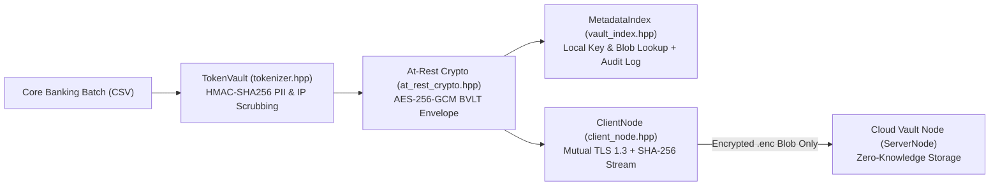

# BlindVault — Zero-Knowledge RegTech Storage Gateway

[](https://github.com/OmarAhmedTHE25th/P2P_Secure_File_Sharing/actions/workflows/ci.yml)
[](https://github.com/OmarAhmedTHE25th/P2P_Secure_File_Sharing/releases/latest)
[](LICENSE)


A high-throughput, zero-knowledge storage gateway and secure transfer engine written in C++20 with Boost.Asio, OpenSSL 3, and Qt 6. Designed for banking and RegTech compliance, **BlindVault** sits between a bank's core transaction perimeter and low-cost commodity cloud storage—stripping PII, masking internal/client IP addresses, encrypting payloads at rest with **AES-256-GCM**, and streaming blobs over **mutual TLS 1.3** with strict certificate fingerprint pinning.

Even if the remote storage server is compromised or inspected by an untrusted administrator, the cloud node holds zero customer identities, zero IP metadata, and zero decryption keys.

## Contents

- [Architecture & RegTech Pipeline](#architecture--regtech-pipeline)
- [Core Features](#core-features)
- [Quick Start](#quick-start)
- [Opening the Qt 6 Desktop Console](#opening-the-qt-6-desktop-console)
- [CLI Usage](#cli-usage)
- [How It Works](#how-it-works)
- [Threat Model](#threat-model)
- [Known Limitations](#known-limitations)
- [Testing & Fuzzing](#testing--fuzzing)
- [Project Structure](#project-structure)
- [License](#license)

## Architecture & RegTech Pipeline

BlindVault separates **identity & key ownership** (strictly inside the bank's perimeter) from **bulk encrypted storage** (offloaded to low-cost object/disk storage):



1. **Pre-Egress Sanitization (`tokenizer.hpp`):** Parses transaction records in memory, replaces customer names, National IDs, and IBANs with deterministic `TOK_<16-hex>` HMAC-SHA256 tokens, and redacts source IP addresses (`REDACTED_IP`) to eliminate IP-based data leakage.
2. **Client-Side Encryption at Rest (`at_rest_crypto.hpp`):** Wraps the scrubbed payload in a binary `BVLT` envelope encrypted with **AES-256-GCM** (random 96-bit IV + 128-bit authentication tag). Encryption keys never leave the bank perimeter.
3. **Zero-Trust Transport (`client_node.hpp` & `tls_trust.hpp`):** Streams the `.enc` blob over **TLS 1.3** with mutual certificate fingerprint verification and end-to-end **SHA-256** integrity checks.
4. **Targeted Auditor Re-Hydration (`vault_index.hpp` & `vault_gateway.hpp`):** Authorized auditors query by customer name, National ID, or IBAN; the gateway resolves the exact `.enc` blob via the local index, decrypts it in memory, re-hydrates the tokens, and records an immutable compliance audit entry.

## Core Features

- **Zero-Knowledge Cloud Offloading:** Remote storage nodes only receive `BVLT` AES-256-GCM ciphertext blobs—never plaintext PII, internal IP addresses, or AES keys.
- **Deterministic O(1) Tokenization:** In-memory bidirectional `TokenVault` backed by HMAC-SHA256 and atomic disk persistence (`vault_tokens.tsv`).
- **Mutual TLS 1.3 with Per-Node Identities:** Only TLS 1.3 is accepted. Each node generates its own EC P-256 keypair and certificate, authenticating peers strictly via SHA-256 certificate fingerprints (`trusted_peers.txt`).
- **End-to-End Integrity & Tamper Detection:** Combines transport-layer SHA-256 verification (`PacketHeader`) with at-rest AES-256-GCM authentication tags.
- **Disk Exhaustion Protection (`disk_budget.hpp`):** Concurrent uploads reserve space from a shared mutex-protected budget that always preserves a 100 MiB safety margin.
- **Atomic Staging & Strict Validation (`validation.hpp`):** Incoming blobs write to `.part` files, pass explicit cross-OS filename/header sanitization rules, and rename atomically only after SHA-256 verification.
- **Timeouts & Concurrency Limits:** 10-second TLS handshake timeout, 30-second idle session timeout, and a 64-connection ceiling.

## Quick Start

Tested on Ubuntu 24.04 (including WSL) with GCC 13 and Clang 18.

```bash
# 1. Install dependencies (Debian/Ubuntu)
sudo apt update
sudo apt install -y build-essential cmake libboost-dev libboost-system-dev libssl-dev

# 2. Clone and build
git clone https://github.com/OmarAhmedTHE25th/P2P_Secure_File_Sharing.git
cd P2P_Secure_File_Sharing
cmake -S . -B build
cmake --build build
```

## Opening the Qt 6 Desktop Console

The desktop application provides a three-tab RegTech demo and operations console:
1. **Bank Egress Gateway:** Generate synthetic Egyptian banking transaction batches (or load a CSV), scrub PII/IPs, encrypt with AES-256-GCM, view live `records/sec` throughput telemetry, and stream `.enc` blobs to the cloud node.
2. **Auditor Query & Cloud Proof:** Query records by Customer Name, National ID, or IBAN to view the decrypted/re-hydrated bank table alongside a raw hex dump proving what resides on the cloud disk.
3. **Cloud Vault & Node Trust:** Start the local cloud storage receiver node and manage pinned SHA-256 node fingerprints.

```bash
# Install Qt 6 development packages
sudo apt install -y qt6-base-dev libgl1-mesa-dev

# Configure and build the GUI
cmake -S . -B build-gui -DP2P_BUILD_GUI=ON -DP2P_BUILD_TESTS=OFF
cmake --build build-gui --target P2P_Secure_File_Sharing_GUI

# Launch
./build-gui/P2P_Secure_File_Sharing_GUI
```

## CLI Usage

The underlying transport binary also supports headless CLI transfers and identity management:

```text
P2P_Secure_File_Sharing receive <port> [save_folder]
P2P_Secure_File_Sharing send <host> <port> <file>
P2P_Secure_File_Sharing p2p <port> [save_folder]

P2P_Secure_File_Sharing init [--force] [name]
P2P_Secure_File_Sharing fingerprint
P2P_Secure_File_Sharing trust add <fingerprint> <name>
P2P_Secure_File_Sharing trust list
P2P_Secure_File_Sharing trust remove <name|fingerprint>
```

### Setting Up Two Nodes Locally

```bash
cd build
mkdir bank_gateway cloud_vault

# 1. Generate EC P-256 identities
(cd bank_gateway && ../P2P_Secure_File_Sharing init bank_gateway < /dev/null)
(cd cloud_vault  && ../P2P_Secure_File_Sharing init cloud_vault < /dev/null)

# 2. Exchange and pin certificate fingerprints
(cd bank_gateway && ../P2P_Secure_File_Sharing trust add "$(cd ../cloud_vault && ../P2P_Secure_File_Sharing fingerprint | sed 's/^Your fingerprint: //')" cloud_vault)
(cd cloud_vault  && ../P2P_Secure_File_Sharing trust add "$(cd ../bank_gateway && ../P2P_Secure_File_Sharing fingerprint | sed 's/^Your fingerprint: //')" bank_gateway)

# 3. Start Cloud Vault listener (Terminal 1)
(cd cloud_vault && ../P2P_Secure_File_Sharing receive 8080)

# 4. Send an encrypted blob from Bank Gateway (Terminal 2)
(cd bank_gateway && ../P2P_Secure_File_Sharing send localhost 8080 payload.enc)
```

## How It Works

### Wire Protocol (`protocol.hpp`)

Every control message uses a packed **47-byte big-endian header**:

| Offset | Size | Field | Meaning |
|-------:|-----:|-------|---------|
| 0 | 1 | `msg_type` | `0x01` METADATA, `0x02` CHUNK (reserved), `0x03` END_OF_FILE, `0x04` ACK |
| 1 | 4 | `payload_len` | Bytes following the header (filename length for METADATA) |
| 5 | 8 | `total_file_size` | Total payload size in bytes |
| 13 | 2 | `filename_len` | Filename byte length |
| 15 | 32 | `file_hash` | SHA-256 digest of the complete file |

### At-Rest Encrypted Envelope (`at_rest_crypto.hpp`)

Every `.enc` object offloaded to cloud storage uses a 32-byte binary header followed by AES-256-GCM ciphertext:

| Offset | Size | Field | Meaning |
|-------:|-----:|-------|---------|
| 0 | 4 | `magic` | ASCII `BVLT` (`0x42 0x56 0x4C 0x54`) |
| 4 | 12 | `iv` | 96-bit CSPRNG nonce (`RAND_bytes`) |
| 16 | 16 | `auth_tag` | 128-bit AES-GCM integrity tag |
| 32 | *N* | `ciphertext` | AES-256-GCM encrypted, tokenized CSV payload |

## Threat Model

| Threat | Mitigation | Verification |
|--------|------------|--------------|
| Cloud storage breach or rogue cloud admin | Client-side AES-256-GCM encryption + HMAC-SHA256 PII tokenization prior to egress; keys and token vault never leave the bank | Unit tests (`test_vault_core.cpp`) |
| IP-based tracking or network topology leakage | Source/internal IP fields are stripped (`REDACTED_IP`) before packaging; nodes authenticate by certificate fingerprint rather than IP | Unit tests (`test_vault_core.cpp`) |
| Eavesdropping or MITM in transit | Mutual TLS 1.3 only (TLS 1.2 refused) with strict SHA-256 fingerprint allowlisting on both ends | Unit & E2E tests (`test_e2e_trust.cpp`, `e2e_test.sh`) |
| Ciphertext or stream tampering | AES-256-GCM authentication tag verification at rest + SHA-256 stream digest verification in transit | Unit & E2E tests |
| Path traversal & malicious filenames | Cross-OS strict filename rules rejecting separators, `:`, control chars, hidden files, and Windows device names | Unit tests & libFuzzer (`fuzz_validation`) |
| Disk exhaustion DoS | Shared mutex-protected `DiskBudget` reservation pool keeping 100 MiB free + 10 GiB per-file cap | Unit tests (`test_disk_budget.cpp`) |
| Memory corruption in network parsers | ASan + UBSan CI builds and continuous libFuzzer runs on header/filename parsing | GitHub Actions CI |

## Known Limitations

- **On-Prem Key & Token Vault Protection:** The local token map (`vault_tokens.tsv`) and metadata index (`vault_index.tsv`) rely on host filesystem permissions; production deployment requires HSM/KMS key wrapping and encrypted database storage.
- **No Resume for Interrupted Streams:** Partial `.part` files are discarded on timeout or disconnect and must be re-sent from byte 0.
- **Global Connection Cap:** The 64-connection ceiling is global rather than per-IP rate-limited.

## Testing & Fuzzing

```bash
# Build and run all GoogleTest unit tests + end-to-end TLS script
cmake -S . -B build
cmake --build build
ctest --test-dir build --output-on-failure < /dev/null

# Run with AddressSanitizer + UndefinedBehaviorSanitizer
cmake -S . -B build-san -DCMAKE_BUILD_TYPE=Debug -DP2P_SANITIZE=ON
cmake --build build-san
ctest --test-dir build-san --output-on-failure < /dev/null

# Run libFuzzer on header & filename validation (requires Clang)
cmake -S . -B build-fuzz -DCMAKE_CXX_COMPILER=clang++ -DP2P_BUILD_TESTS=OFF -DP2P_BUILD_FUZZERS=ON
cmake --build build-fuzz --target fuzz_validation
mkdir -p corpus-work
./build-fuzz/fuzz_validation corpus-work fuzz/seeds -max_total_time=60
```

## Project Structure

```text
main.cpp              CLI entry point and argument parsing
vault_gateway.hpp     End-to-end RegTech pipeline orchestrator & synthetic CBE data generator
tokenizer.hpp         Deterministic HMAC-SHA256 PII tokenizer & IP scrubber
at_rest_crypto.hpp    AES-256-GCM authenticated encryption/decryption (BVLT envelope)
vault_index.hpp       Local metadata index & immutable compliance audit logger
cli_identity.hpp      Identity generation, fingerprint display, and trust commands
identity.hpp          EC P-256 keypair & self-signed X.509 certificate management
trust_store.hpp       Pinned SHA-256 peer fingerprint allowlist
tls_trust.hpp         Mutual TLS 1.3 fingerprint verification callbacks
p2p_node.hpp          Interactive P2P node wrapper
server_node.hpp       Async TCP/TLS acceptor with connection limits & handshake timeouts
server_session.hpp    Per-transfer receiving state machine with atomic .part writes
client_node.hpp       Async outgoing TLS 1.3 file/blob streamer
validation.hpp        Pure header and filename sanitization rules
disk_budget.hpp       Thread-safe shared disk-space reservation pool
protocol.hpp          47-byte big-endian wire protocol definitions
file_streaming.hpp    64 KiB chunked SHA-256 file hashing
gui/                  Qt 6 desktop application and Boost.Asio thread bridge
tests/                GoogleTest unit & integration test suites
fuzz/                 libFuzzer target and seed corpus
scripts/              End-to-end TLS test harness and certificate helpers
```

## License

MIT — see [LICENSE](LICENSE).