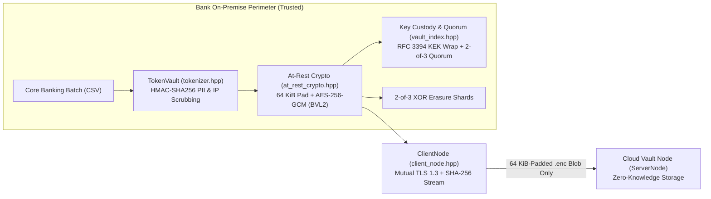

# BlindVault — Hardened Zero-Knowledge RegTech Storage Gateway

A high-throughput, zero-knowledge storage gateway and secure transfer engine written in C++20 with Boost.Asio, OpenSSL 3, and Qt 6. Designed for banking and RegTech compliance, **BlindVault** sits between a bank's core transaction perimeter and low-cost commodity cloud storage—stripping PII, masking internal/client IP addresses, padding payloads to fixed 64 KiB buckets, encrypting at rest with **AES-256-GCM (`BVL2`)**, wrapping batch keys under a Master KEK via **RFC 3394**, and streaming blobs over **mutual TLS 1.3** with strict certificate fingerprint pinning.

Even if the remote storage server is compromised or inspected by an untrusted administrator, the cloud node holds zero customer identities, zero IP metadata, zero batch-size signals, and zero decryption keys. Inside the bank perimeter, unmasking customer PII requires **2-of-3 Compliance Officer Quorum** cryptographic sign-off.

## Contents

* [Architecture & Hardened RegTech Pipeline](#architecture--hardened-regtech-pipeline)
* [Core & Hardening Features](#core--hardening-features)
* [Quick Start](#quick-start)
* [Opening the Qt 6 Desktop Console](#opening-the-qt-6-desktop-console)
* [CLI Usage](#cli-usage)
* [How It Works](#how-it-works)
* [Threat Model](#threat-model)
* [Known Limitations](#known-limitations)
* [Testing & Fuzzing](#testing--fuzzing)
* [Project Structure](#project-structure)
* [License](#license)

## Architecture & Hardened RegTech Pipeline

BlindVault separates **identity, key custody, and quorum governance** (strictly inside the bank's perimeter) from **bulk encrypted storage** (offloaded to low-cost commodity object/disk storage):



1. **Pre-Egress Sanitization (`tokenizer.hpp`):** Parses transaction records in memory, replaces customer names, National IDs, and IBANs with deterministic `TOK_<16-hex>` HMAC-SHA256 tokens, and redacts source IP addresses (`REDACTED_IP`) to eliminate IP-based data leakage.
2. **Traffic-Analysis Padding & Encryption at Rest (`at_rest_crypto.hpp`):** Pads the scrubbed payload with CSPRNG noise to an exact multiple of **64 KiB** (`65,536` bytes) to defeat file-size traffic analysis, then seals it in a binary `BVL2` envelope using **AES-256-GCM** (96-bit IV + 128-bit authentication tag).
3. **HSM-Style Key Wrapping, Memory Cleansing & Erasure Sharding (`at_rest_crypto.hpp`):** Wraps each batch's Data Encryption Key (DEK) under a Master Key Encryption Key (KEK) via **RFC 3394 (`EVP_aes_256_wrap`)** so zero plaintext keys ever touch disk, wipes plaintext keys and decrypted buffers from RAM via RAII `OPENSSL_cleanse` (`RLIMIT_CORE=0`), and splits blobs into **2-of-3 XOR erasure shards** for multi-cloud resilience.
4. **Zero-Trust Transport (`client_node.hpp` & `tls_trust.hpp`):** Streams `.enc` blobs over **TLS 1.3** with mutual certificate fingerprint verification and end-to-end **SHA-256** integrity checks.
5. **M-of-N Quorum Auditor Re-Hydration (`vault_index.hpp` & `vault_gateway.hpp`):** Authorized auditors query by customer name, National ID, or IBAN only after collecting valid cryptographic HMAC approvals from at least **2 of 3 Compliance Officers**. The gateway unwraps the DEK, decrypts in memory, re-hydrates tokens, cleanses RAM, and appends an immutable compliance audit entry.

## Core & Hardening Features

* **Zero-Knowledge Cloud Offloading:** Remote storage nodes only receive 64 KiB-padded `BVL2` AES-256-GCM ciphertext blobs—never plaintext PII, internal IP addresses, batch size signatures, or AES keys.
* **RFC 3394 Envelope Key Wrapping:** Per-batch DEKs are wrapped with a 256-bit Master KEK before persisting to `vault_index.tsv`; plaintext keys never touch disk.
* **2-of-3 Compliance Officer Quorum Gate:** Enforces multi-custody cryptographic HMAC authorization before `detokenize()` unmasks customer PII, blocking solo insider scraping.
* **RAII Memory Zeroization & Core-Dump Lock:** `SecretKey` and `SecretBuffer` scrub sensitive material from RAM with `OPENSSL_cleanse()` on destruction, paired with `RLIMIT_CORE=0` process hardening.
* **2-of-3 XOR Erasure Coding:** Generates 3 parity/data shards per encrypted batch so any 2 storage providers reconstruct the full ciphertext while 1 compromised or offline provider reveals nothing.
* **Deterministic O(1) Tokenization:** In-memory bidirectional `TokenVault` backed by HMAC-SHA256 and atomic disk persistence (`vault_tokens.tsv`).
* **Mutual TLS 1.3 with Per-Node Identities:** Only TLS 1.3 is accepted. Each node generates its own EC P-256 keypair and certificate, authenticating peers strictly via SHA-256 certificate fingerprints (`trusted_peers.txt`).
* **Disk Exhaustion Protection & Atomic Staging (`disk_budget.hpp`, `validation.hpp`):** Concurrent uploads reserve space from a shared mutex-protected budget keeping a 100 MiB safety margin, write to `.part` files, and rename atomically only after SHA-256 verification.

## Quick Start

Tested on Ubuntu 24.04 (including WSL) with GCC 13 and Clang 18.

```bash
# 1. Install dependencies (Debian/Ubuntu)
sudo apt update
sudo apt install -y build-essential cmake libboost-dev libboost-system-dev libssl-dev

# 2. Clone and build
git clone https://github.com/OmarAhmedTHE25th/P2P_Secure_File_Sharing.git
cd P2P_Secure_File_Sharing
cmake -S . -B build
cmake --build build
```

## Opening the Qt 6 Desktop Console

The desktop application provides a three-tab RegTech demo and operations console:

1. **Bank Egress Gateway:** Generate synthetic Egyptian banking transaction batches (or load a CSV), scrub PII/IPs, pad to 64 KiB, wrap DEKs via RFC 3394, generate 2-of-3 erasure shards, view live `records/sec` throughput telemetry, and stream `.enc` blobs to the cloud node.
2. **Quorum Auditor & Cloud Proof:** Toggle **2-of-3 Compliance Officer** cryptographic sign-offs, query records by Customer Name, National ID, or IBAN to view the decrypted/re-hydrated bank table alongside a raw hex dump proving what resides on the cloud disk.
3. **Cloud Vault & Node Trust:** Start the local cloud storage receiver node and manage pinned SHA-256 node fingerprints.

```bash
# Install Qt 6 development packages
sudo apt install -y qt6-base-dev libgl1-mesa-dev

# Configure and build the GUI
cmake -S . -B build-gui -DP2P_BUILD_GUI=ON -DP2P_BUILD_TESTS=OFF
cmake --build build-gui --target P2P_Secure_File_Sharing_GUI

# Launch
./build-gui/P2P_Secure_File_Sharing_GUI
```

## CLI Usage

The underlying transport binary also supports headless CLI transfers and identity management:

```text
P2P_Secure_File_Sharing receive <port> [save_folder]
P2P_Secure_File_Sharing send <host> <port> <file>
P2P_Secure_File_Sharing p2p <port> [save_folder]

P2P_Secure_File_Sharing init [--force] [name]
P2P_Secure_File_Sharing fingerprint
P2P_Secure_File_Sharing trust add <fingerprint> <name>
P2P_Secure_File_Sharing trust list
P2P_Secure_File_Sharing trust remove <name|fingerprint>
```

### Setting Up Two Nodes Locally

```bash
cd build
mkdir bank_gateway cloud_vault

# 1. Generate EC P-256 identities
(cd bank_gateway && ../P2P_Secure_File_Sharing init bank_gateway < /dev/null)
(cd cloud_vault  && ../P2P_Secure_File_Sharing init cloud_vault < /dev/null)

# 2. Exchange and pin certificate fingerprints
(cd bank_gateway && ../P2P_Secure_File_Sharing trust add "$(cd ../cloud_vault && ../P2P_Secure_File_Sharing fingerprint | sed 's/^Your fingerprint: //')" cloud_vault)
(cd cloud_vault  && ../P2P_Secure_File_Sharing trust add "$(cd ../bank_gateway && ../P2P_Secure_File_Sharing fingerprint | sed 's/^Your fingerprint: //')" bank_gateway)

# 3. Start Cloud Vault listener (Terminal 1)
(cd cloud_vault && ../P2P_Secure_File_Sharing receive 8080)

# 4. Send an encrypted blob from Bank Gateway (Terminal 2)
(cd bank_gateway && ../P2P_Secure_File_Sharing send localhost 8080 payload.enc)
```

## How It Works

### Wire Protocol (`protocol.hpp`)

Every control message uses a packed **47-byte big-endian header**:

| Offset | Size | Field | Meaning |
| -----: | ---: | ----- | ------- |
| 0 | 1 | `msg_type` | `0x01` METADATA, `0x02` CHUNK (reserved), `0x03` END_OF_FILE, `0x04` ACK |
| 1 | 4 | `payload_len` | Bytes following the header (filename length for METADATA) |
| 5 | 8 | `total_file_size` | Total payload size in bytes |
| 13 | 2 | `filename_len` | Filename byte length |
| 15 | 32 | `file_hash` | SHA-256 digest of the complete file |

### At-Rest Encrypted Envelope (`at_rest_crypto.hpp` — `BVL2`)

Every `.enc` object offloaded to cloud storage uses a 32-byte binary header followed by 64 KiB-aligned AES-256-GCM ciphertext:

| Offset | Size | Field | Meaning |
| -----: | ---: | ----- | ------- |
| 0 | 4 | `magic` | ASCII `BVL2` (`0x42 0x56 0x4C 0x32`) |
| 4 | 12 | `iv` | 96-bit CSPRNG nonce (`RAND_bytes`) |
| 16 | 16 | `auth_tag` | 128-bit AES-GCM integrity tag |
| 32 | *64 KiB × k* | `ciphertext` | AES-256-GCM encrypted `[8B real_len \| tokenized CSV \| CSPRNG padding]` |

## Threat Model

| Threat | Mitigation | Verification |
| ------ | ---------- | ------------ |
| Cloud breach or rogue cloud admin | Client-side AES-256-GCM (`BVL2`) + HMAC-SHA256 PII tokenization prior to egress; keys never leave bank | Unit tests (`test_vault_core.cpp`) |
| IP-based tracking or topology leakage | Source/internal IP fields redacted (`REDACTED_IP`) before packaging; nodes authenticate via SHA-256 cert fingerprints | Unit tests (`test_vault_core.cpp`) |
| Rogue insider bulk PII scraping | **2-of-3 Compliance Officer Quorum Gate** requiring multi-officer cryptographic HMAC sign-off before `detokenize()` | Unit tests (`VaultHardening.EndToEndOffloadZeroLeakageAndQuorumEnforcement`) |
| Host disk compromise / key scraping | **RFC 3394 AES-256 Key Wrapping** (no raw DEKs on disk) + RAII `OPENSSL_cleanse` + `RLIMIT_CORE=0` | Unit tests (`VaultHardening.Rfc3394KeyWrapAnd64KiBTrafficPadding`) |
| Cloud file-size / traffic inference | Fixed-bucket **64 KiB CSPRNG padding** on every `BVL2` envelope | Unit tests (`VaultHardening.Rfc3394KeyWrapAnd64KiBTrafficPadding`) |
| Single-cloud outage or ransomware | **2-of-3 XOR Erasure Sharding** reconstructing full ciphertext from any 2 surviving shards | Unit tests (`VaultHardening.TwoOfThreeErasureCodingSurvivesCloudNodeLoss`) |
| Eavesdropping or MITM in transit | Mutual TLS 1.3 only (TLS 1.2 refused) with strict SHA-256 fingerprint allowlisting on both ends | Unit & E2E tests (`test_e2e_trust.cpp`, `e2e_test.sh`) |
| Path traversal & parser corruption | Cross-OS strict filename/header validation + continuous libFuzzer + ASan/UBSan CI builds | GitHub Actions CI (`fuzz_validation`) |

## Known Limitations

* **Hardware HSM Integration:** The Master KEK (`hsm_master.kek`) and officer signing keys simulate a FIPS 140-3 Level 3 HSM/KMS boundary on local storage; production deployment binds these operations to PKCS#11 HSM hardware.
* **No Resume for Interrupted Streams:** Partial `.part` files are discarded on timeout or disconnect and must be re-sent from byte 0.
* **Global Connection Cap:** The 64-connection ceiling is global rather than per-IP rate-limited.

## Testing & Fuzzing

```bash
# Build and run all GoogleTest unit tests + end-to-end TLS script
cmake -S . -B build
cmake --build build
ctest --test-dir build --output-on-failure < /dev/null

# Run with AddressSanitizer + UndefinedBehaviorSanitizer
cmake -S . -B build-san -DCMAKE_BUILD_TYPE=Debug -DP2P_SANITIZE=ON
cmake --build build-san
ctest --test-dir build-san --output-on-failure < /dev/null

# Run libFuzzer on header & filename validation (requires Clang)
cmake -S . -B build-fuzz -DCMAKE_CXX_COMPILER=clang++ -DP2P_BUILD_TESTS=OFF -DP2P_BUILD_FUZZERS=ON
cmake --build build-fuzz --target fuzz_validation
mkdir -p corpus-work
./build-fuzz/fuzz_validation corpus-work fuzz/seeds -max_total_time=60
```

## Project Structure

```text
src/main.cpp          CLI entry point and argument parsing
include/
  vault/              Bank-side RegTech and zero-knowledge engine
  transport/
    client/           Outgoing transfer and P2P client headers
    server/           Cloud receiver and transfer session headers
    common/           Wire protocol, streaming, and shared events
  security/           mTLS, identities, allowlists, and input/disk guards
gui/                  Qt 6 desktop application and Boost.Asio thread bridge
tests/                GoogleTest unit & integration test suites
fuzz/                 libFuzzer target and seed corpus
scripts/              End-to-end TLS test harness and certificate helpers
```

## License

MIT — see [LICENSE](LICENSE).